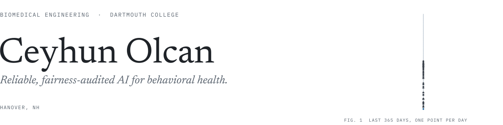

<picture>
  <source media="(prefers-color-scheme: dark)" srcset="assets/header-dark.svg">
  
</picture>

 

I study whether passive signals from phones, wearables, and the environment can reliably model behavioral health over months and years, and I build the methods, audits, and models that make that hold up outside the lab.

Biomedical Engineering at Dartmouth. Research with the AIM HIGH Lab (Geisel) and the Empower Lab (Thayer).

### Questions I'm working on

- Is smartphone missingness a stable trait, or a state that moves with symptoms week to week?
- When wearable signal quality differs across groups, how much of that bias survives into the predictions built on top of it?
- Can a model pretrained on months of unlabeled passive data transfer to a new cohort with only a handful of labels?

### Selected work

**Heads-Up Before the Handoff: Telling Gemma 4 Coding Agents What Comes Next.** 
*Kaggle*, 2026. [Paper](https://doi.org/10.34740/kaggle/w/117440)

**Smartphone missingness as a depression biomarker.** 
Olcan C. *medRxiv*, 2026. [Paper](https://doi.org/10.64898/2026.04.30.26351977) · [Code](https://github.com/ceyhunolcan/biomedical-signal-forensics-lab) 
In the StudentLife cohort, days with sparse phone data carry more depression signal than dense ones. The gaps are the symptom.

**Reliability of passive sensing data: a multi-method evaluation in depression.** 
Langener, Lee, Castro-Alvarez, Lampe, Enbar-Salo, Ramrakhiani, Olcan, Dorris, Price, Heinz, et al. *PsyArXiv*, 2026. [Paper](https://doi.org/10.31234/osf.io/uydqj_v1)

**Olfactory dysfunction, daytime activity reduction, and 24-hour rhythm fragmentation, but not food-odor recognition, in NHANES 2013-2014.** 
Olcan C. *Research Square*, 2026. [Paper](https://doi.org/10.21203/rs.3.rs-9830931/v1) · [Code](https://github.com/ceyhunolcan/od-activity-rhythm)

**Moderate-to-severe olfactory dysfunction marks accelerated phenotypic aging in U.S. adults.** 
Olcan C. *Research Square*, 2026. [Paper](https://doi.org/10.21203/rs.3.rs-9646723/v1)

### Now

[longitudinal-health-foundation-model](https://github.com/ceyhunolcan/longitudinal-health-foundation-model) &nbsp;Self-supervised pretraining over months of wearable, smartphone, and environmental streams. 
[biomedical-signal-forensics-lab](https://github.com/ceyhunolcan/biomedical-signal-forensics-lab) &nbsp;Quality, drift, and fairness audits for wearable physiological signals. 
[xClimate](https://xclimate.co) &nbsp;Climate and health.

 

[xclimate.co](https://xclimate.co) &nbsp;·&nbsp; [ORCID](https://orcid.org/0000-0002-6326-6071) &nbsp;·&nbsp; [LinkedIn](https://www.linkedin.com/in/ceyhun-olcan/) &nbsp;·&nbsp; Open to research collaborations

Header figure: my last 365 days on GitHub, one point per day, rebuilt nightly. Papers sync from ORCID.
